# 📐 Microsoft Fabric Direct Lake Semantic Model Design & TMDL Blueprint

This document details the **Semantic Model Architecture**, **Entity Relationships**, and **TMDL (Tabular Model Definition Language)** specification for the Pre-Sales Analytics engine in Microsoft Fabric.

---

## ⚡ 1. Direct Lake Mode Architecture

In Microsoft Fabric, **Direct Lake** provides the best of both worlds:
1. **DirectQuery Speed & Freshness**: No scheduled data import or VertiPaq database refresh is required. Power BI queries Delta Parquet files in OneLake directly.
2. **Import-like Sub-Second Performance**: The VertiPaq engine loads columns directly from OneLake Parquet files into memory on demand without translation to SQL queries.

```
+-----------------------------------------------------------------------------------+
|                        OneLake Delta Tables (Gold Layer)                         |
|   gold_dim_date, gold_dim_account, gold_dim_solution_engineer, gold_dim_product,  |
|   gold_fact_presales_activity, gold_fact_poc, gold_fact_opportunity_snapshot     |
+-----------------------------------------------------------------------------------+
                                          │
                                          ▼ [Direct Lake: Native Parquet V-Order Columnar Load]
+-----------------------------------------------------------------------------------+
|                     Power BI Direct Lake Semantic Model Engine                    |
|   - 1:M Single-Direction Relationships                                            |
|   - Native In-Memory VertiPaq Transcoding                                         |
|   - Fallback Prevention: Fixed Type Mapping & Proper String Collation             |
+-----------------------------------------------------------------------------------+
                                          │
                                          ▼ [Interactive Analytics]
+-----------------------------------------------------------------------------------+
|                    Power BI Reports, Copilot, & Mobile Dashboards                 |
+-----------------------------------------------------------------------------------+
```

### Direct Lake Fallback Prevention Rules
To ensure the semantic model stays in **Direct Lake** mode and never falls back to DirectQuery:
1. **Delta Parquet V-Order**: All Gold tables are written with `spark.sql.parquet.vorder.enabled = true`.
2. **Compatible Data Types**: Avoid complex nested structs or unsupported binary formats.
3. **Surrogate Keys**: Integer/BigInt surrogate keys (`date_key`, `account_sk`, `se_sk`, `opportunity_sk`) provide maximum compression in VertiPaq dictionaries.
4. **No Calculated Columns in Direct Lake Model**: All calculated columns are computed upstream in PySpark (Silver/Gold notebooks) rather than DAX calculated columns.

---

## 🗺️ 2. Star Schema Entity-Relationship Diagram

```mermaid
erDiagram
    gold_dim_date ||--o{ gold_fact_opportunity_snapshot : "created_date_key (Active)"
    gold_dim_date ||--o{ gold_fact_opportunity_snapshot : "actual_close_date_key (Inactive)"
    gold_dim_date ||--o{ gold_fact_presales_activity : "activity_date_key"
    gold_dim_date ||--o{ gold_fact_poc : "start_date_key"
    gold_dim_date ||--o{ gold_fact_rfp : "request_date_key"

    gold_dim_account ||--o{ gold_fact_opportunity_snapshot : "account_sk"
    gold_dim_account ||--o{ gold_fact_presales_activity : "account_sk"
    gold_dim_account ||--o{ gold_fact_poc : "account_sk"

    gold_dim_solution_engineer ||--o{ gold_fact_presales_activity : "se_sk"
    gold_dim_solution_engineer ||--o{ gold_fact_poc : "lead_se_sk"
    gold_dim_solution_engineer ||--o{ gold_fact_opportunity_snapshot : "assigned_se_sk"
    gold_dim_solution_engineer ||--o{ gold_fact_rfp : "assigned_se_sk"

    gold_dim_product ||--o{ gold_fact_opportunity_snapshot : "product_sk"
    gold_dim_product ||--o{ gold_fact_poc : "product_sk"
    gold_dim_product ||--o{ gold_fact_presales_activity : "product_sk"

    gold_dim_opportunity ||--o{ gold_fact_opportunity_snapshot : "opportunity_sk"
    gold_dim_opportunity ||--o{ gold_fact_presales_activity : "opportunity_sk"
    gold_dim_opportunity ||--o{ gold_fact_poc : "opportunity_sk"
    gold_dim_opportunity ||--o{ gold_fact_rfp : "opportunity_sk"

    gold_dim_activity_type ||--o{ gold_fact_presales_activity : "activity_type_sk"
```



---

## 🔗 3. Relationship Matrix & Cardinality

| From Table (Many) | Foreign Key | To Table (One) | Primary Key | Cross Filtering | Status |
| :--- | :--- | :--- | :--- | :--- | :--- |
| `gold_fact_opportunity_snapshot` | `created_date_key` | `gold_dim_date` | `date_key` | Single (1 $\rightarrow$ *) | **Active** |
| `gold_fact_opportunity_snapshot` | `actual_close_date_key`| `gold_dim_date` | `date_key` | Single (1 $\rightarrow$ *) | *Inactive* (`USERELATIONSHIP`) |
| `gold_fact_opportunity_snapshot` | `account_sk` | `gold_dim_account` | `account_sk` | Single (1 $\rightarrow$ *) | **Active** |
| `gold_fact_opportunity_snapshot` | `product_sk` | `gold_dim_product` | `product_sk` | Single (1 $\rightarrow$ *) | **Active** |
| `gold_fact_opportunity_snapshot` | `assigned_se_sk` | `gold_dim_solution_engineer` | `se_sk` | Single (1 $\rightarrow$ *) | **Active** |
| `gold_fact_opportunity_snapshot` | `opportunity_sk` | `gold_dim_opportunity` | `opportunity_sk` | Single (1 $\rightarrow$ *) | **Active** |
| `gold_fact_presales_activity` | `activity_date_key`| `gold_dim_date` | `date_key` | Single (1 $\rightarrow$ *) | **Active** |
| `gold_fact_presales_activity` | `se_sk` | `gold_dim_solution_engineer` | `se_sk` | Single (1 $\rightarrow$ *) | **Active** |
| `gold_fact_presales_activity` | `activity_type_sk`| `gold_dim_activity_type` | `activity_type_sk` | Single (1 $\rightarrow$ *) | **Active** |
| `gold_fact_presales_activity` | `opportunity_sk` | `gold_dim_opportunity` | `opportunity_sk` | Single (1 $\rightarrow$ *) | **Active** |
| `gold_fact_poc` | `start_date_key` | `gold_dim_date` | `date_key` | Single (1 $\rightarrow$ *) | **Active** |
| `gold_fact_poc` | `lead_se_sk` | `gold_dim_solution_engineer` | `se_sk` | Single (1 $\rightarrow$ *) | **Active** |
| `gold_fact_poc` | `opportunity_sk` | `gold_dim_opportunity` | `opportunity_sk` | Single (1 $\rightarrow$ *) | **Active** |
| `gold_fact_poc` | `product_sk` | `gold_dim_product` | `product_sk` | Single (1 $\rightarrow$ *) | **Active** |
| `gold_fact_rfp` | `request_date_key` | `gold_dim_date` | `date_key` | Single (1 $\rightarrow$ *) | **Active** |
| `gold_fact_rfp` | `assigned_se_sk` | `gold_dim_solution_engineer` | `se_sk` | Single (1 $\rightarrow$ *) | **Active** |
| `gold_fact_rfp` | `opportunity_sk` | `gold_dim_opportunity` | `opportunity_sk` | Single (1 $\rightarrow$ *) | **Active** |

---

## 📝 4. Tabular Model Definition Language (TMDL) Excerpt

When creating the semantic model in Microsoft Fabric or using Tabular Editor 3 / ALM Toolkit, the relationships and table configurations can be defined via TMDL:

```tmdl
model PreSalesAnalyticsDirectLake
    compatibilityLevel: 1604
    defaultPowerBIDataSourceVersion: powerBI_V3

relationship Rel_Opp_Date_Created
    fromColumn: gold_fact_opportunity_snapshot.created_date_key
    toColumn: gold_dim_date.date_key

relationship Rel_Opp_Date_Close
    isActive: false
    fromColumn: gold_fact_opportunity_snapshot.actual_close_date_key
    toColumn: gold_dim_date.date_key

relationship Rel_Opp_Account
    fromColumn: gold_fact_opportunity_snapshot.account_sk
    toColumn: gold_dim_account.account_sk

relationship Rel_Act_Date
    fromColumn: gold_fact_presales_activity.activity_date_key
    toColumn: gold_dim_date.date_key

relationship Rel_Act_SE
    fromColumn: gold_fact_presales_activity.se_sk
    toColumn: gold_dim_solution_engineer.se_sk

relationship Rel_POC_Date
    fromColumn: gold_fact_poc.start_date_key
    toColumn: gold_dim_date.date_key

relationship Rel_POC_SE
    fromColumn: gold_fact_poc.lead_se_sk
    toColumn: gold_dim_solution_engineer.se_sk

table gold_dim_date
    lineageTag: 37d452d3-469b-466a-bda7-762bc125f4a1

    column date_key
        dataType: int64
        formatString: 0
        isKey
        sourceColumn: date_key

    column full_date
        dataType: dateTime
        formatString: yyyy-mm-dd
        sourceColumn: full_date

    column year
        dataType: int64
        sourceColumn: year

    column quarter
        dataType: string
        sourceColumn: quarter

    column month_name
        dataType: string
        sortByColumn: month_num
        sourceColumn: month_name

    column month_num
        dataType: int64
        isHidden
        sourceColumn: month_num
```
